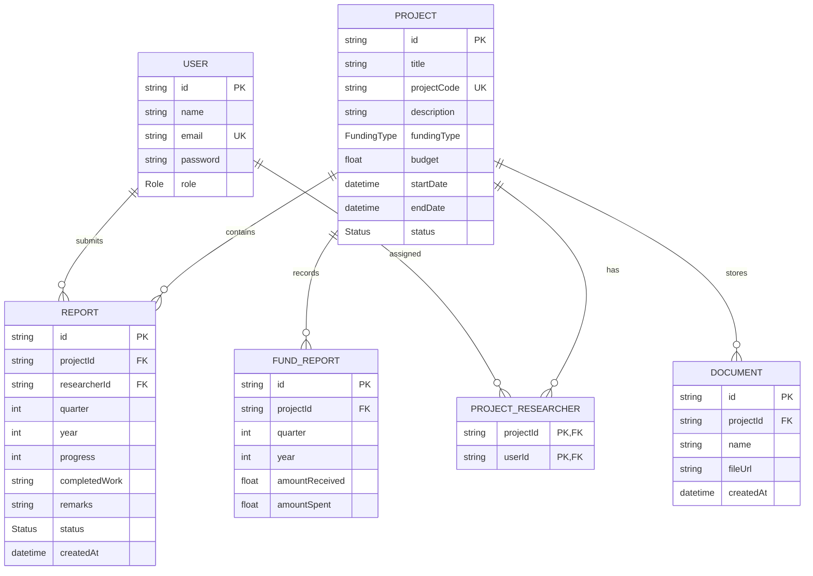

# Data Model and ER Diagram

## Entities and key attributes

| Entity | Primary key | Important attributes |
| --- | --- | --- |
| `User` | `id` | `name`, unique `email`, `role`, `password` |
| `Project` | `id` | unique `projectCode`, `title`, `fundingType`, `budget`, `status`, dates |
| `Report` | `id` | `projectId`, `researcherId`, `quarter`, `year`, `progress`, `status` |
| `FundReport` | `id` | `projectId`, `quarter`, `year`, `amountReceived`, `amountSpent` |
| `Document` | `id` | `projectId`, `name`, `fileUrl`, `createdAt` |
| `_ProjectResearchers` | (`A`, `B`) | join table linking project `A` to user `B` |

## Relationships

- One `Project` has many `Report` records.
- One `User` can submit many `Report` records.
- One `Project` has many `FundReport` records.
- One `Project` has many `Document` records.
- `Project` and `User` have a many-to-many relationship through
  `_ProjectResearchers`.
- A project and its reporting period are unique for both progress and fund
  reports (`projectId, quarter, year`).

## ER diagram

